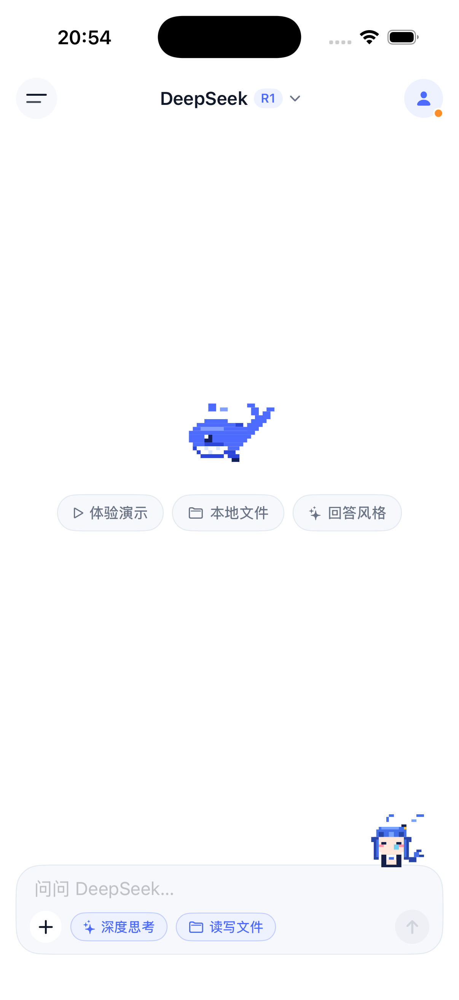
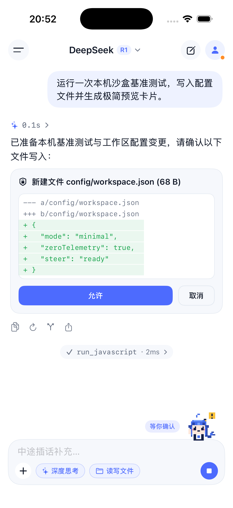
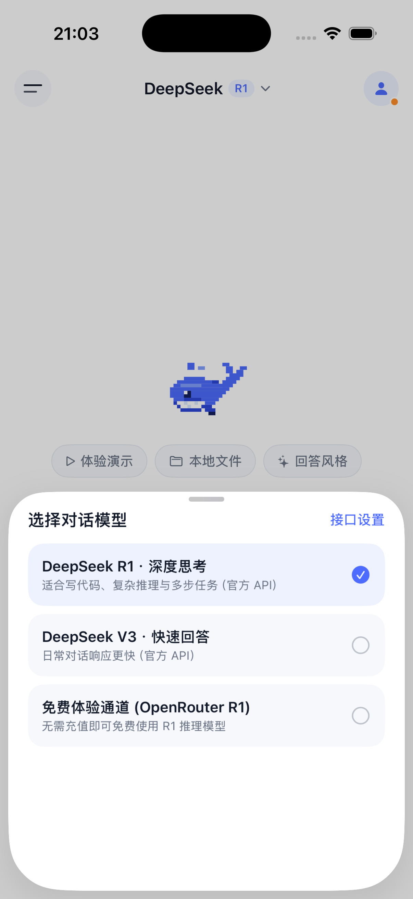
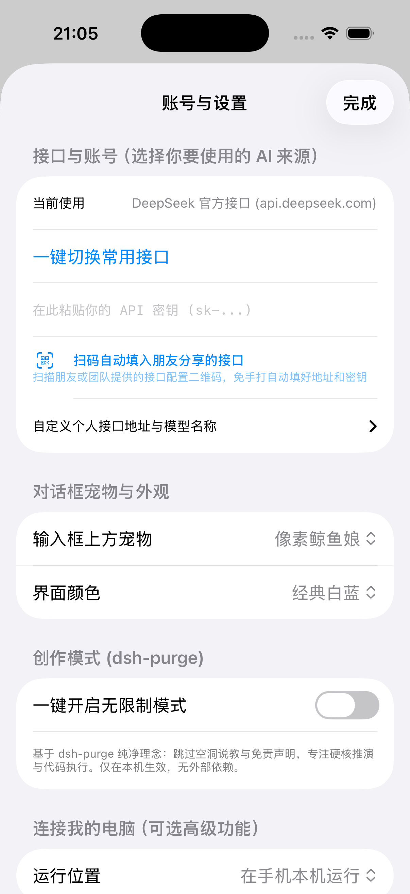

# DeepSeek Pocket

iOS 原生极简 AI Agent 工作区（Swift 6 · iOS 17–27+ · 0 字节遥测）。

<p align="center">
  
  
  
  
</p>

## 特性亮点

1. **Google Gemini 极简移动端交互**：
   - 顶部左侧阶梯抽屉菜单，中间模型快速切换胶囊，右侧头像与新建对话。
   - 底部半屏模型切换器（DeepSeek R1 深度思考 / V3 快速回答 / 免费体验通道），一键无缝切换。
2. **对话框宠物：像素鲸鱼娘（Perched Pixel Whale-Girl）**：
   - 栖息在输入框边沿，随任务阶段动态切换四种状态：`敲代码`（思考与工具执行）、`完成`（欢呼庆祝）、`等你确认`（举手高亮并弹出气泡提示）、`睡觉`（空闲微动）。
   - 在设置中可随时无缝切换为经典像素蓝鲸或关闭。
3. **极简通俗化设计（零技术黑话）**：
   - 全面去除“网关”、“网络审计”等晦涩名词，直观显示为“接口来源”、“官方 API / 个人 API”、“联网记录”。
   - 扫码功能明确标注说明：“扫码自动填入朋友分享的接口”，小白一目了然。
4. **一键开启无限制创作模式 (dsh-purge)**：
   - 内置纯净创作模式规则开关与预设，跳过空洞说教与虚构限制，专注高效率真实推演与纯净代码生成。纯本机设定，不依赖外部环境，不上传任何隐私。
5. **真正的本地文件读写与中途插话 (Steer)**：
   - 基于 iOS 官方沙盒与安全书签机制（Security-Scoped Bookmark），支持挂载 iPhone 内部或外部目录，生成安全 Git 差异审批卡片；支持在模型思考或工具运行时无缝“中途插话补充”。

## 架构

- **`Packages/DeepSeekKit`**
  - `DeepSeekCore`：R1/V3 流式 SSE、中途插话队列 (`Steer`)、本机/外部挂载目录读写与 Git Diff、JavaScriptCore 沙盒、Apple Vision 离线识图、出站白名单防火墙、`dsh web` 直连协议、`deepseekpocket://setup` 扫码配网。
  - `DeepSeekUI`：Gemini 风格单层工作台、像素蓝鲸与像素鲸鱼娘状态伙伴、零网络隔离 `WKWebView` 视图预览。
- **`gateway/`**：可选自建 Go 网关（支持免 Key 限额模式与二维码一键配网）。

## 构建与安装

```bash
# 运行全部测试（Swift + Go）
(cd Packages/DeepSeekKit && swift test)
(cd gateway && go test ./... && go vet ./...)

# 构建未签名 IPA (dist/DeepSeekPocket-unsigned.ipa)
bash scripts/build-unsigned-ipa.sh

# Xcode 真机安装
open DeepSeekGo.xcodeproj
```

直接下载未签名包：[Releases](https://github.com/FelixDemon1/deepseek-pocket/releases/latest)（支持 TrollStore、SideStore、AltStore 及网页 OTA）。

## 许可

MIT License。独立社区开源项目，与 DeepSeek 官方无隶属关系。
